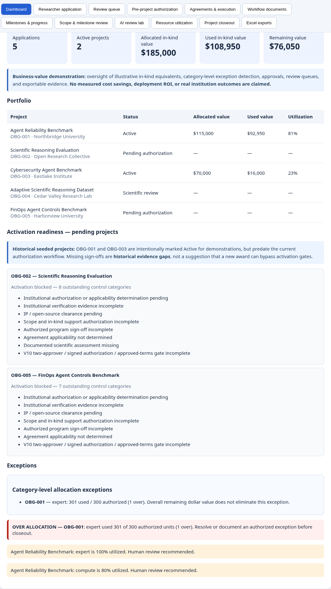
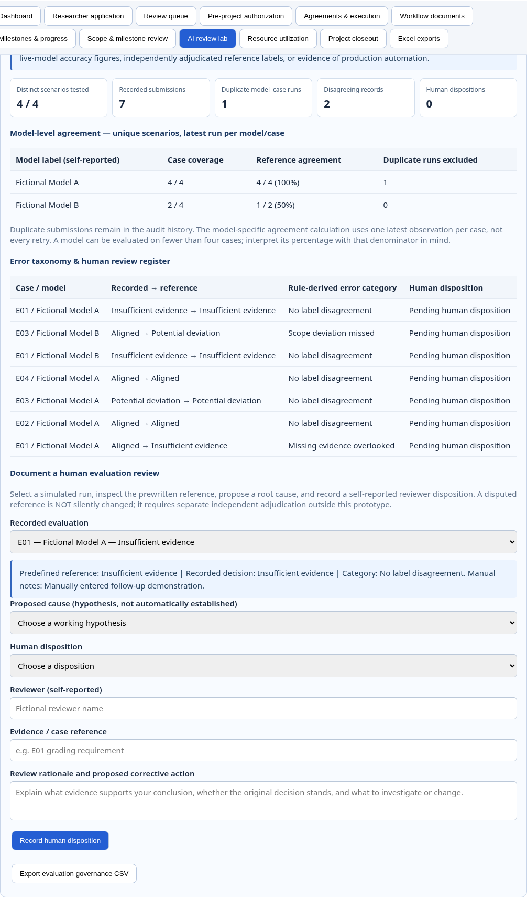
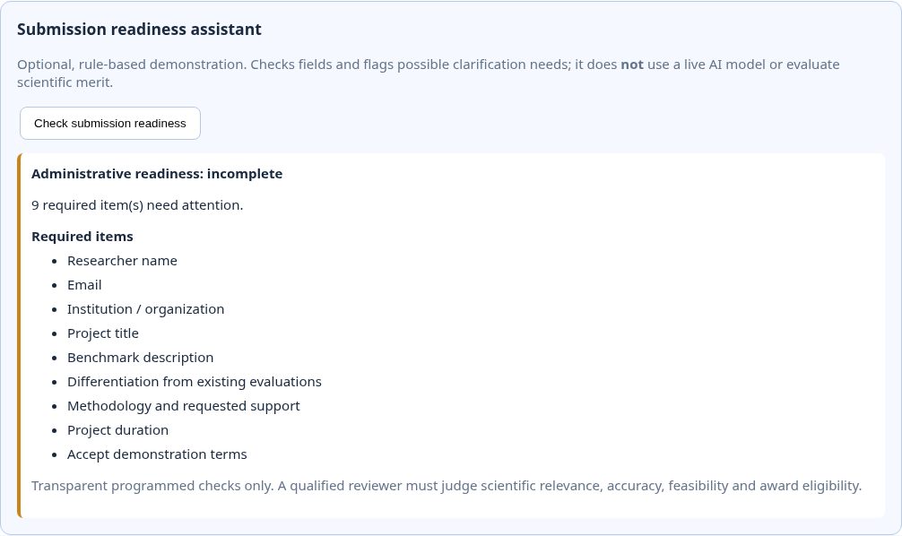
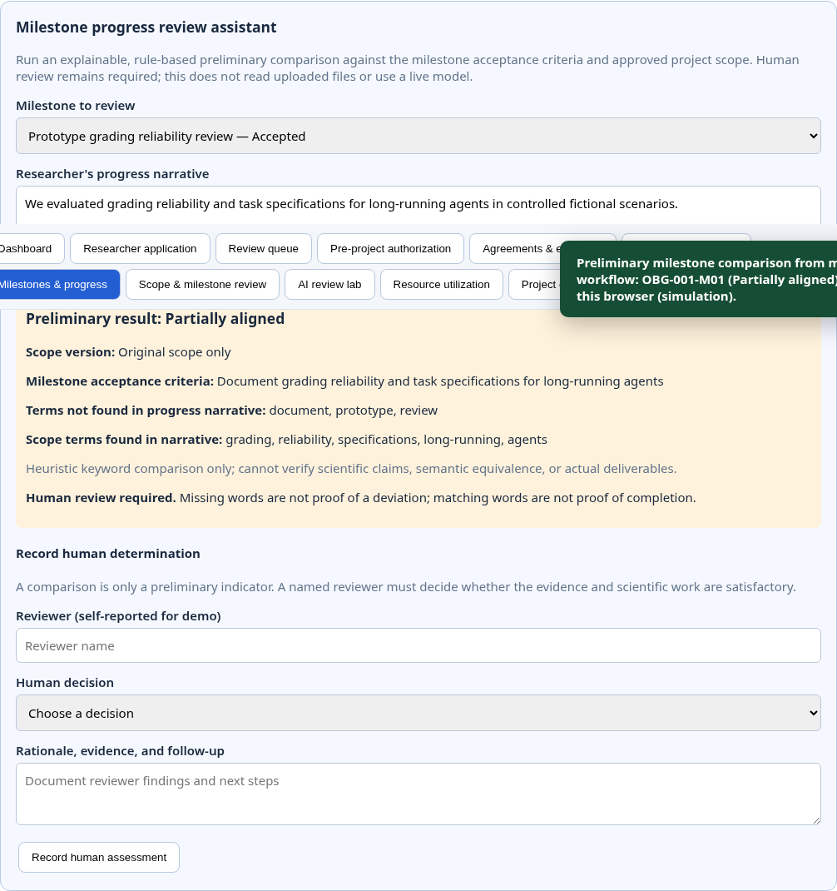

# Open Benchmarks Grants OS — Research Operations & AI Evaluation

**An independent, fictional portfolio prototype** demonstrating how a program leader might manage a complex research grants lifecycle, financial-equivalent resource governance, control exceptions, and human-supervised AI evaluation.

**Not affiliated with, endorsed by, or deployed at Snorkel AI.** The design is inspired by the public concept of open benchmark research grants. It is not a copy of Snorkel's internal workflow, and its sample controls are illustrative, not claims about Snorkel policy.

**Start here:** Open `index.html` locally in a browser or publish this repository using GitHub Pages. Select **5-minute demo guide** above the navigation. All records are fictional. The prototype has no backend or login.

## What this demonstrates

| Workflow | Demonstration |
| --- | --- |
| Research application intake | Researchers enter project, approach and support requests; **inline rule-based readiness assistant** highlights missing required fields and opportunities for reviewer clarification |
| Scientific assessment | Named reviewer, merit, feasibility, resources and documented selection rationale |
| Award and activation controls | Two separate award decisions, required rationale for changing recorded decisions, readiness checklist, project-specific blockers |
| Agreements and evidence | Central evidence register and self-reported verification; no claim of authentic signatures |
| Milestone monitoring | Due dates, milestone acceptance, evidence reference, reviewer notes; **inline scope/criteria comparison and recorded human assessment** |
| Resource governance | Category-level consumption, remaining in-kind support, over-allocation prevention and reconciliation |
| Controlled amendments | Request/approver separation, before/after authorization, supporting references and structured audit |
| AI evaluation governance | Manually entered simulated recommendations compared with predefined fictional reference decisions; per-model unique-case coverage, duplicate-run reporting, error categories, human decisions and documented cause hypotheses |
| Reporting and audit | Fictional portfolio metrics, structured audit history and CSV exports |

## Five-minute demonstration

1. **Dashboard:** Review five fictional applications, two active projects and the seeded category-level resource exception. Aggregate remaining resources do not conceal a category overage.
2. **Application & scientific review:** Open **Researcher application**, enter a fictional draft and select **Check submission readiness**. Then open the review queue to inspect the Cedar Valley scientific assessment.
3. **Authorization:** Open **OBG-005** to examine an incomplete activation gate and the required rationale for changing a previous decision.
4. **Resource utilization:** Open **OBG-001**. It begins with 301 expert hours used against 300 authorized. Submit an amendment; the approved allocation changes *only after* a different self-reported reviewer approves the increase. The original terms remain in the audit history.
5. **Milestones & AI review lab:** Open **Milestones & progress** on OBG-001, enter a fictional progress narrative, run the preliminary comparison, and record a human disposition. Then open **AI review lab** to see unique-case coverage and investigate the fictional E03 mismatch.
6. **Exports:** Download `audit_structured_v11.csv`, `evaluation_governance.csv` and `resource_amendments.csv`. **Reset fictional demo** clears changes saved in this browser.

## Key business and financial illustration

The public fixture starts with **$185,000 in authorized in-kind equivalent value**, **$108,950 used** and **$76,050 remaining** across two active fictional projects. One expert-hours category is 301/300, and the dashboard explicitly flags the exception despite the positive overall portfolio balance. These are *fictional valuation assumptions*, **not cash grants, actual company spend, realized savings or production results**.

## How workflow assistance works

The Application and Milestones tabs offer **deterministic, explainable checks**, not live AI predictions. Submission readiness flags missing fields and short explanatory responses; milestone review uses existing approved-scope and keyword comparison rules and preserves a human decision in the scope-review record. It cannot parse a real document or establish scientific merit. These features demonstrate **where AI-assisted review could support operations** if an actual model were connected and validated.

## How the AI lab actually works

The application **does not call an AI model**. It can prepare a model-ready JSON request, but all test predictions were entered manually. Each test case has a **predefined fictional reference**. The lab compares the entered prediction to that reference, shows latest-run agreement per unique case and model, identifies duplicates, and applies **transparent deterministic mismatch categories**. Reviewers can record a suggested cause, evidence reference and disposition. Disputing a reference never silently rewrites the original. None of these examples establish genuine model accuracy, scientific validity, or independently verified human ground truth.

## Architecture

- Standalone HTML + CSS + vanilla JavaScript; no remote dependencies or backend.
- State stored in the browser's `localStorage`, isolated per browser/site origin. Not a multi-user database; there is **no authenticated identity, access control, tamper-proof log or immutable server ledger**.
- Files uploaded to the demonstration are stored locally in browser data, subject to the 250 KB per-file limit. Uploaded or attested documents are not cryptographically authenticated.
- Export actions produce downloadable CSVs; the prototype cannot securely store or share confidential, regulated, or real applicant data.
- A fresh browser starts with self-contained fictional examples. The author’s local UAT records are **not** included.

See [Release review](RELEASE_REVIEW.md) for verification status and limitations.

## Local use

Download or clone the repository and open `index.html` in a modern browser. This is a static site. No build or API keys are required. Do not enter sensitive or actual grant or financial records. Use **Reset fictional demo** to restore the fictional seed (this deletes browser-local changes for that origin).

## Hosting on GitHub Pages

1. Keep `index.html` at the repository root.
2. In the repository, open **Settings → Pages** and select **Deploy from a branch → main / (root)**.
3. Verify the public URL in a clean or private browser. Confirm that the guide, seeded data, navigation, local reset, and CSV exports work before sharing it publicly.

GitHub Pages is not enabled by this package. Publishing a URL is a separate step.

## Suggested portfolio narrative

The challenge is not only processing proposals. It is connecting scientific decision-making with financial and resource visibility, evidence requirements, issue management, and effective human oversight of automated recommendations. This prototype illustrates how business and governance requirements can be translated into a working interface and evaluated through control scenarios and regression tests.

## Planned, not implemented

Real model inference or agents; signed identity and authorization; secure multi-user storage; independent scientific adjudication; verified document signatures; measured cost savings; full demand forecasting and twelve-month resource-capacity scenarios. These are roadmap items, **not** features demonstrated in the current release candidate.
